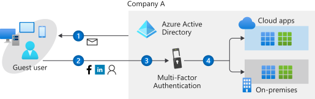
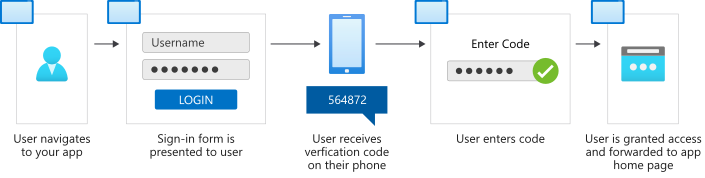
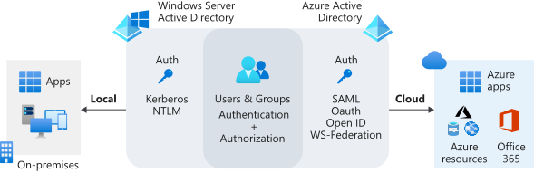
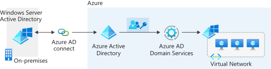
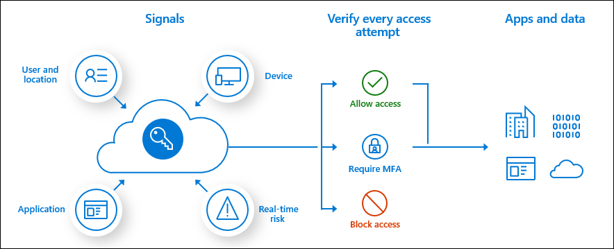
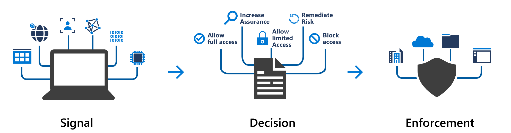

---
tags:
  - Microsoft Azure
  - Identity & Access Management
---

!!! note "Name changes"
    Azure Active Directory (Azure AD) got renamed to Microsoft Entra ID in 2023. A lot of the product names under it changed too: Azure AD Connect is Microsoft Entra Connect, Azure AD Domain Services is Microsoft Entra Domain Services, Identity Protection is Microsoft Entra ID Protection, and Premium P1/P2 are Microsoft Entra ID P1/P2. I updated the names below.

- One tenant can have multiple Azure subscriptions. A tenant is your organization, and it stores all the users in that organization. Whoever creates the tenant gets billing and admin rights to it.

- What is Microsoft Entra ID?

    - It's a cloud based identity service. It uses authentication to make sure you are who you say you are, and authorization to figure out what you have access to.

- What can you do with Entra ID?

    - Application management: manage your cloud and on-prem apps.

    - Authentication: things like self-service password reset (SSPR) and MFA.

    - Conditional Access: control who can get to your cloud apps and under what conditions.

    - Device management: control how your cloud or on-prem devices get to corporate data.

- Terminology

    - Entra ID account: an identity created in Entra ID or in a service like Microsoft 365. These identities live in Entra ID. For example, employees use their Entra ID accounts every day at work.

    - Owner: an Azure RBAC role that can manage all Azure resources (and give other people access).

    - Global Administrator: an Entra role that can do every admin function in the tenant. Keep this list really short.

    - Tenant: an instance of Entra ID. It gets created for you automatically the first time you sign up for Azure or something like Microsoft 365. It holds your users, groups, and applications, and it represents your organization.

    - Directory: everything in the tenant you need for identity and access management. It's like the security desk's list with all the info on everyone who works in the office.

    - Identity: something that has to be identified and authenticated. Usually it's a user with a username and password, but apps and services have identities too.

    - Account: an identity plus the data that goes with it. An account can't exist without an identity.

    - Azure subscription: your access to use Azure and its services, and where the billing happens. For pay-as-you-go you set it up with a credit card. Bigger companies might use an Enterprise Agreement. One account can use many subscriptions.

    - Multi-tenant: multiple tenants (so multiple organizations) using the same apps and services in a shared environment.

    - Custom domain: when you create a tenant, Azure gives it a default domain like `<your-organization>.onmicrosoft.com`. You can add your own domain so users sign in as `joesmith@contoso.com` instead of `joesmith@contoso.onmicrosoft.com`.

Users

||Entra ID|Active Directory|
|---|---|---|
|User Provisioning|Manual, script, or synced from on-prem AD with Entra Connect. Can also connect to cloud HR systems|Manual, script, or workflow through an HR system|
|External Identities|B2B collaboration manages external users and makes them visible in Entra ID|External users usually created by hand, often in a separate external AD forest|
|Entitlement Management|Access to groups, apps, and resources handed out by policy|Manual entitlement management through AD groups|
|Group Management|Manual and rule-based membership (assigned and dynamic groups)|Manual group management|

Applications

||Active Directory|Entra ID|
|---|---|---|
|Infrastructure Apps|Network controls|Cloud control plane|
|Traditional and Legacy apps|LDAP, Kerberos, or header based authentication to control access|Microsoft Entra application proxy|
|SaaS Apps|No native support, needs AD FS|Supports OAuth 2.0, SAML, and WS-Federation|
|Line of Business (LOB) Apps with Modern Auth|Can use AD FS with Active Directory|Can be set up to use Entra ID for authentication|

Device Management

||Active Directory|Entra ID|
|---|---|---|
|Mobile Devices|No native support|Intune integration|
|Windows Desktop Devices|Domain join, Group Policy, or Configuration Manager (SCCM)|Entra join, managed with Intune and Conditional Access|
|Windows Servers|Managed with Group Policy|Can be managed with Microsoft Entra Domain Services|
|Linux/Unix Workloads|No native support|Linux VMs in Azure can use Entra ID sign-in, and workloads can use managed identities|

- B2B (business to business) collaboration is for when you need to let users from a partner or supplier sign in, no matter what identity provider they use, and manage the lifecycle of those guest users. Guests live in the same directory as your employees and can be added to the same groups and resources. B2B is part of Microsoft Entra External ID now.

- Azure AD B2C (business to customer) is for customer-facing apps, like letting the public sign up and log in to your store. Those accounts live in a separate B2C directory, completely apart from your employees, and they're managed by the customer or by the app. Heads up: B2C stopped being sold to new customers on May 1, 2025. Existing customers can keep using it (supported until at least May 2030), but anything new should use Microsoft Entra External ID.

- You set up your apps to use Entra ID through application management.

- Apps in Entra ID can use Conditional Access, application proxy for on-prem legacy apps, and SaaS app integrations.

- A directory in Entra ID holds all the users, groups, and apps you need for identity and access management.

- Facebook, Google, LinkedIn, and Microsoft accounts can all be used to sign in with B2C (and External ID).

- Microsoft 365 groups and security groups are the 2 types of groups in Entra ID.

- HR system provisioning, entitlement management, and built-in RBAC roles are features you get with Entra ID that on-prem Active Directory doesn't have.

- The identity secure score shows how good your identity security is and gives you recommendations to improve it.

- Entra ID is a cloud based identity solution for managing users and apps. Active Directory manages objects like devices and users on your on-prem network.

|Service|Authentication|Structure|What it's used for|
|---|---|---|---|
|Active Directory|Kerberos, NTLM|Forests, domains, organizational units|Authentication and authorization for on-prem printers, apps, file shares, and more|
|Microsoft Entra ID|SAML, OAuth 2.0, OpenID Connect, WS-Federation|Tenants|Internet-based services and apps like Microsoft 365, Azure, and third party SaaS apps|

- Microsoft Entra ID P2 includes ID Protection, which lets you set up risk-based Conditional Access to protect your apps from identity-based risks.

- Microsoft Entra Domain Services lets you domain join VMs without running your own domain controllers.

- Microsoft Entra ID Protection automatically detects, investigates, and fixes identity risks for users (like leaked credentials or sign-ins from weird locations). You can also export all the risk data to other tools, like Microsoft Sentinel, for more analysis. It uses risk policies to respond to threats automatically.

- Conditional Access is basically an if/then statement. If a user wants to get to a resource, then they have to do something first. It goes signal, then decision, then enforcement. For example, a payroll manager wants to open the payroll app, so they have to do MFA first.

- Conditional Access needs a Microsoft Entra ID P1 license.

- Group membership, location, device compliance, the app being accessed, and risky sign-in behavior are all common signals used in Conditional Access.

- Role based access control (RBAC) lets you choose who gets access, what resources they can get to, and where (the scope) that access applies.

- There are 4 best practices for RBAC: only give users the access they need, limit the number of subscription owners, use PIM where you can, and assign roles to groups instead of individual people.

- Privileged Identity Management (PIM) gives you more control over your most important resources. You can manage, control, and monitor who has access to them.

- In PIM, admins assign roles to users as eligible (they have to activate it) or active. Admins can set how long it lasts, and whether it needs MFA or approval to activate.

- PIM limits access to important resources by making it time-based and approval-based (just-in-time access), which cuts down on misuse and people having way more access than they need. You need a Microsoft Entra ID P2 or Microsoft Entra ID Governance license to use it.

- Entitlement management makes managing employee access to company resources easier. Assigning access, reviewing it, and the whole access lifecycle get automated instead of someone doing it all by hand.

- In Entra ID, Enterprise applications > Users and groups > Add user/group lets you assign users or groups to an app.

- A hybrid identity setup (on-prem AD synced to Entra ID with Entra Connect) makes it easier for your organization to manage on-prem and cloud identities together.

- Self-service provisioning lets users do the Microsoft Entra join process themselves, either during the Windows out-of-box experience (OOBE) or from Windows settings.

[Documentation | Microsoft Learn](https://learn.microsoft.com/entra/fundamentals/whatis)
