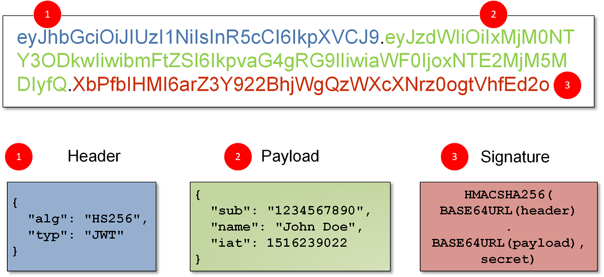

---
tags:
  - Cybersecurity
  - Identity & Access Management
---

## The Big Picture: Open Standards

Federation is a concept to have trust between an IdP (Entra ID) and SPs (Slack) for authentication and authorization. You can achieve this with standards like OAuth 2.0, SAML, and OpenID Connect.

OAuth 2.0 is where the SP sends you to a login page at the IdP (Google) to sign in, then trades an authorization code for tokens. The response has an Access Token (tells the API what you have access to) and a Refresh Token (gets new access tokens without logging in again). When OpenID Connect is used on top of it, you also get an ID Token (a JWT that says who you are).

SAML is another federation method used more at the enterprise level, whereas OpenID Connect is lightweight and used for browsers/mobile. OIDC handles the authentication (Identity) while OAuth 2.0 handles the authorization (Access).

JWK is the public key used to verify the signature of a JWT. The server must rotate these keys often for security.

### Questions I've asked myself

#### *Where does the signature go in a JWT?*

The signature is the third part of the JWT. The first part is the header, which describes the algorithm used, and the second part is the payload (the data itself, the claims). Each part is separated by a period.

#### *Does the payload get encrypted? If so, with what? what is the security behind this? Especially if someone can capture the JWT and misuse it for malicious purposes.*

The payload isn't encrypted, it's just Base64URL encoded, so anyone who has the token can read it. Attackers can capture a JWT, but it isn't easy while it's traveling over HTTPS (TLS encrypts it in transit). They're more likely to steal it with phishing, malware, or an adversary-in-the-middle proxy. The security of a JWT is integrity: if an attacker grabs the JWT and changes, let's say, the role in the payload, the signature won't match anymore and the API rejects it. That doesn't stop them from replaying a stolen token as-is until it expires though, which is why short token lifetimes matter. Never put sensitive info like passwords in a JWT payload. (If you actually need an encrypted token, that's a JWE.)

#### *How will the API know it's different since the RSA algorithm isn't a hashing algorithm?*

When the IdP creates the signature, it hashes the header and payload (with SHA-256 for RS256) and then signs that hash with its private key. The API recomputes the hash from the token it received and uses the IdP's public key (from the JWKS) to check the signature. If even one character in the payload changed, the hashes won't match and the check fails. So RSA isn't the hashing part, SHA-256 is. RSA is the signing part.

[Article | Auth0](https://auth0.com/docs/get-started/applications/signing-algorithms)

[Article](https://datatracker.ietf.org/doc/html/rfc7518#section-3.3)

### Questions I've asked strangers on the internet

#### *Hello everyone, I was thinking of integrating a SAML 2.0, OAuth2/OIDC, and a SCIM-enabled application to Entra ID. This is for homelab purposes and I'm trying to wrap my head around the process. Is it better to run them in Active Directory and then integrate them with Entra ID or am I confusing myself?*

You may be confusing yourself.

SAML 2.0 and OAuth/OIDC are both standards for single sign on (SAML performs both AuthZ and AuthN whereas OAuth is an AuthZ standard and OIDC is an extension of that standard that enables AuthN) which pass attributes to their 3rd party application, SCIM is just a way to automatically handle the identity in systems external from your base IdP (handles the identity lifecycle which makes integrations for systems that require it much less hands on after initial deployment) - technical term for the operation SCIM supports is called CRUD (create, read, update, and delete).

A comparable solution in on premise active directory would be ADFS (which is on its way out, or really already should be).

Technically (without some extra work) you'll only be doing this integration directly with Entra.

You'll usually be provisioning identities to On-Premise AD and they'll flow to Entra (via Entra Connect) for usage of large scale single sign on integrations.

#### *Another question that stems up from this answer. Why not keep all of this on prem? What is the benefit for leveraging all of this in Entra ID? Trying to understand the why behind the two IdPs. I understand SAML is used mostly in enterprise environments and OAuth/OpenID connect is more modern browser based.*

Cuz you'd then have to manage ADFS infrastructure (and I'm sure of a multitude of other reasons) which is big and clunky.

Modern SSO requires modern solutions.

The real benefit of Entra isn't just the hosting, its the security of it .

If you were to choose to stay on-premise with ADFS, you'd miss out on awesome features like CA. Entra lets you say things like "Only allow login if the user is on a compliant device, in the US, and using MFA". Building that level of granularity on prem is a friggin nightmare (or at times frankly impossible). Most **forward-thinking** orgs are only keeping on-prem AD for legacy stuff that requires Kerberos/LDAP (like file shares or printers) and Servers (which although infrastructure isn't my side of the house, my understanding is that Windows Server does not contain the MDM stack as part of the OS, making management in Intune *impossible*(?), someone can check me on that).

> My follow-up after checking: they're right that Intune doesn't manage Windows Server like a laptop. But servers can be managed through Azure Arc, and Defender for Endpoint security settings management can push security policies from Intune to Windows Servers.

Also for ADFS, you'd be managing the infrastructure yourself (security - must maintain a public facing ADFS server, and overall maintenance), imagine how helpful it is taking that reliance off of your back and allowing the real experts to handle it.

#### *What is the difference between Kerberos, SAML, and OIDC?*

The easiest way to distinguish them is by **"Where they live"** and **"What language they speak."**

Here is the breakdown:

1. Kerberos lives inside the Corporate Network (Intranet/Active Directory).  When you log into your work laptop, you get a "Ticket Granting Ticket" (TGT). Whenever you access a file share or a printer _inside_ the office network, your laptop secretly slides this ticket to the server. It hates the internet. It requires the client (laptop) to have a direct line of sight to the Domain Controller. You generally cannot use Kerberos to log into a cloud app like Salesforce from a coffee shop without a VPN. You unlock your Windows laptop (Authentication to the OS).

2. SAML lives in the Web (specifically Browser-based Enterprise SaaS). It sends **XML** documents via the browser. It bridges the gap between your Internal Network (Active Directory) and External Apps (ServiceNow/Office 365). It was designed for desktop web browsers. It is technically difficult (and painful) to make it work inside a mobile app or a desktop client that isn't a browser. You open your browser to access the Corporate Portal. The Portal trusts your Windows login (via Kerberos) and generates a SAML assertion to log you into Salesforce.

3. OIDC lives everywhere (Web, Mobile, Single Page Apps, APIs). It uses **JSON (JWTs)** via REST APIs. It is built for the modern internet where "The App" might be on a phone, a watch, or a smart TV. It is friendly to developers and mobile devices because JSON is native to the web (Javascript). You pull out your phone and open the Salesforce App. The app uses OIDC (e.g. Google) to log you in because mobile apps struggle with SAML XML.

[Blog Article | Medium](https://medium.com/@tolulinux/i-finally-understand-kerberos-ldap-radius-tacacs-heres-my-simple-breakdown-1f9561b5c9ae)

[Article | Blumira](https://www.blumira.com/blog/authentication-protocols-101)
