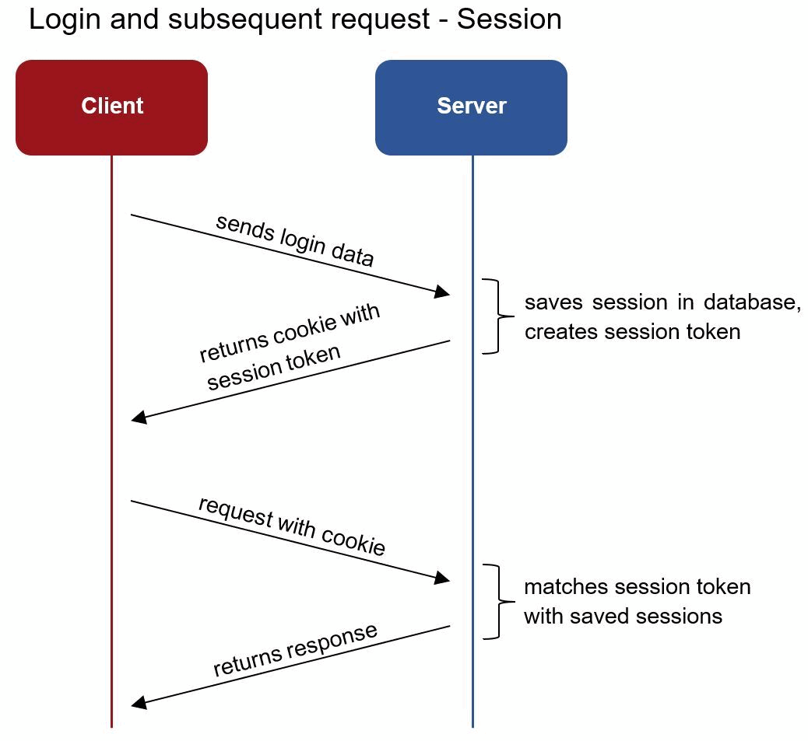
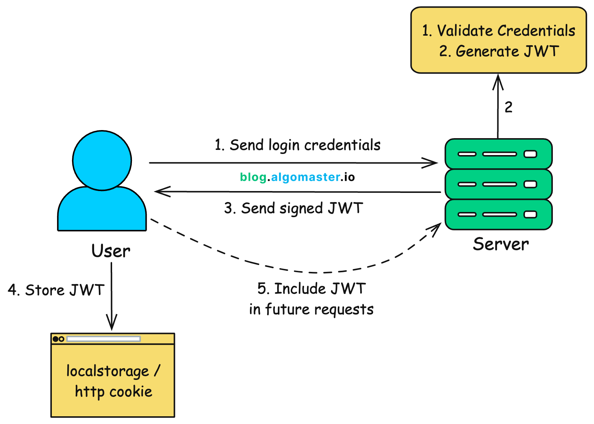
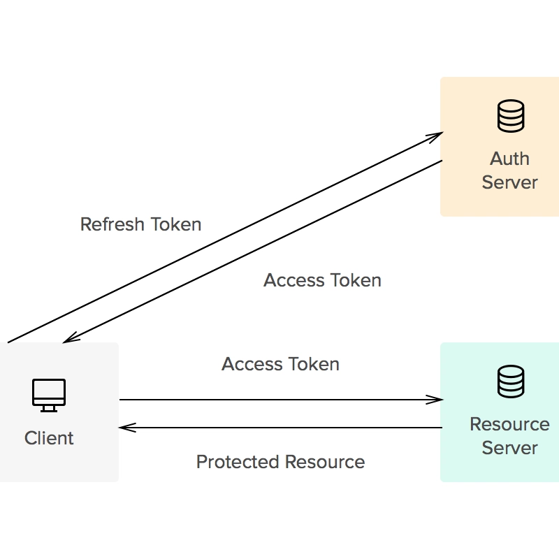
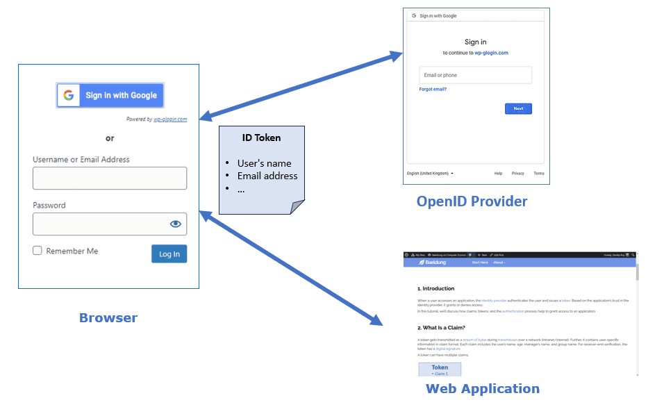

---
tags:
  - Cybersecurity
  - Identity & Access Management
---

## Claims

User attributes, or data about the user, like email address, full name, etc. The asserting party (IdP) tells the API (eg. Microsoft Graph, Intune) about your (subject) claims (attributes) and what you're authorized to do.

They are embedded in tokens and only accepted if the asserting party is trusted.

[Documentation | Curity](https://curity.io/resources/learn/what-are-claims-and-how-they-are-used/)

## Tokens

They're basically a pass to get into the club so you don't hate outside of it (a little joke), and you can use that same pass for different types of clubs too. In technical terms, it's a piece of data that proves you're allowed to access protected resources.

There are different types of authentication tokens:

### Session

This one is authenticate once and done. The server sends you a unique session ID that gets stored in your browser cookies, and the server keeps it on its side too so it remembers the ID is yours. Every time you do something, that same ID is used to prove it's you.

[Documentation | Wikipedia](https://en.wikipedia.org/wiki/Session_ID)

### JWT

This is a really common token in IT. It's kind of like a session token, but the difference is that instead of the server handing you an ID and storing it, the token is digitally signed (integrity). So if you show the JWT to any resource or server in your environment, it can check the signature itself and trust it, without having to hit up another server to see if you're legit.

It also holds your claims (attributes).

[Documentation | Wikipedia](https://en.wikipedia.org/wiki/JSON_Web_Token)

#### These tokens can be used together:

##### Access

It's a temporary key that gives you access to certain applications. For example, the token might give you an hour of access to that service. It also proves what you can do, since the token carries the permissions (scopes or roles) you have in that application. It answers the question '_what is the user allowed to do?_'

[Documentation | Wikipedia](https://en.wikipedia.org/wiki/Access_token)

[Documentation | Auth0](https://auth0.com/docs/secure/tokens/access-tokens)

##### ID

A badge you walk around with that answers the question '_who is this person?_'. An application can read this token and greet you by name.

[Documentation | Auth0](https://auth0.com/docs/secure/tokens/id-tokens)

##### Refresh

Lastly we have refresh tokens, which are pretty straightforward. When an access token expires, the refresh token is your renewal voucher that says 'hey, this person is trusted, please send them another access token.' It's there so you don't have to go through the whole authentication process again. Since they last a lot longer, refresh tokens are a juicy target for attackers, so protect them.

[Documentation | Auth0](https://auth0.com/docs/secure/tokens/refresh-tokens)

[Blog Article | Medium](https://medium.com/@sweetondonie/5-types-of-authentication-tokens-every-beginner-should-know-5073ca9b2319) - To learn about the five types of authentication tokens.

[Documentation | Geeks for Geeks](https://www.geeksforgeeks.org/computer-networks/session-vs-token-based-authentication/) - To learn the difference between a session and a token based authentication
